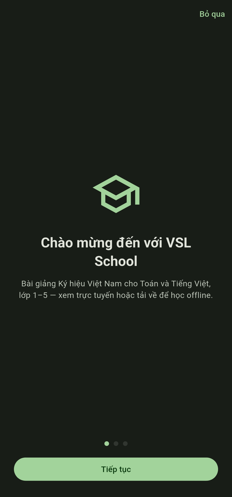
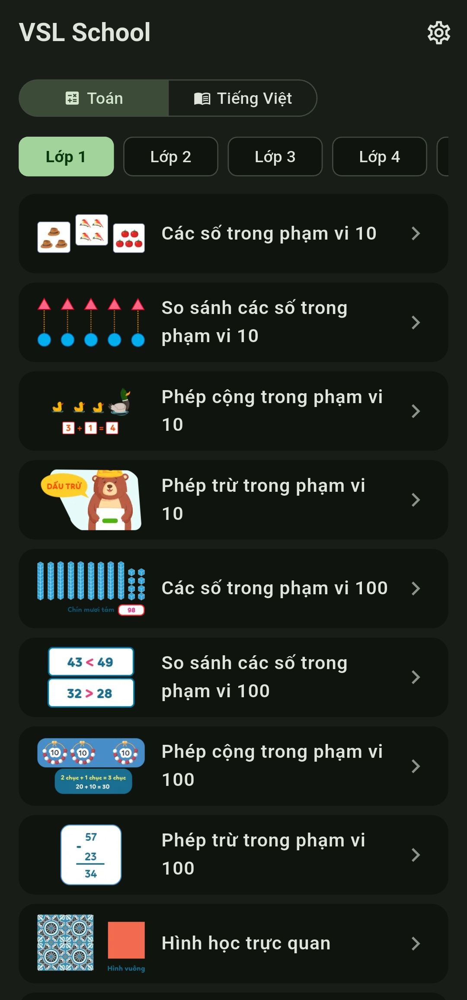
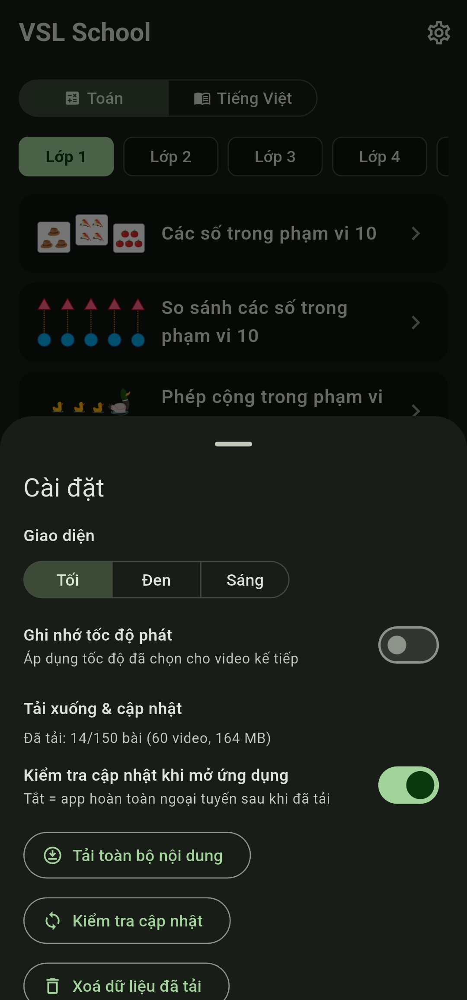
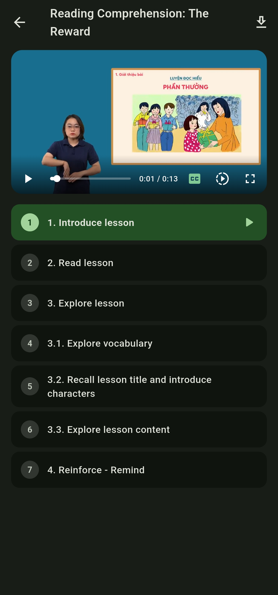
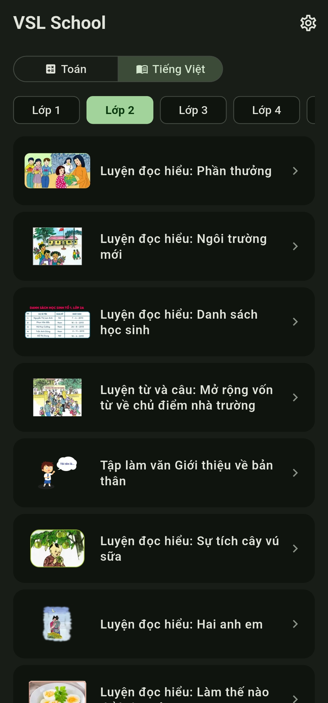
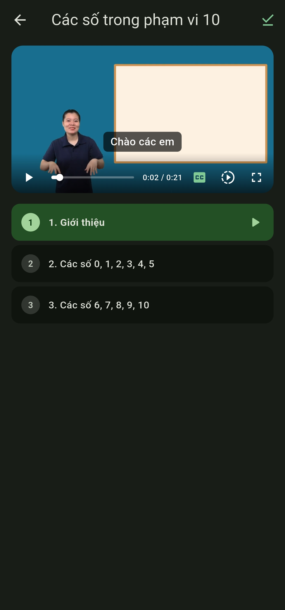

# VSL School — Trường học Ký hiệu Việt Nam

**English** | [Tiếng Việt](README.vi.md)

[](https://github.com/ngozz/vsl-school/actions/workflows/build.yml)
[](LICENSE)
[](https://github.com/ngozz/vsl-school/releases)
<!-- F-Droid: [](https://f-droid.org/packages/com.ngozz.vsl_school/) -->

An offline-first Flutter app of sign-language **video lessons** — Math
(Toán) and Literature (Tiếng Việt) for grades 1–5, following Vietnam's
national primary-school curriculum. Distilled from the "App Khiem Thinh"
lesson app into a lightweight reader with a custom video player. Interface
in Vietnamese or English.

**Source data:** lesson content, videos and captions from the National Sign
Language portal of [qipedc.moet.gov.vn (App Khiem Thinh)](https://qipedc.moet.gov.vn/)
(Trung tâm Ký hiệu Việt Nam / Bộ Giáo dục và Đào tạo).

## Languages

- **Interface:** Vietnamese or English (Settings → Language; also asked on
  first launch).
- **Content:** everything being taught is originally **Vietnamese** — the
  national primary-school curriculum, lesson titles, outlines, captions and
  the videos themselves. English titles, outlines and subtitles are a
  translated companion layer, shown in English mode; Vietnamese mode stays
  purely Vietnamese.
- Subject naming follows the interface: **Toán** is *Math*, and **Tiếng Việt**
  (the Vietnamese reading/writing subject) is *Literature* in English.
- *Translation note:* English text was translated with AI assistance and
  partially reviewed by hand. Some lines may still read awkwardly —
  corrections are very welcome via issues.

## Install

- **Android:** latest signed APK from
  [Releases](https://github.com/ngozz/vsl-school/releases)
  (`vsl-school-android.apk` — the **lite** flavor: lessons stream from the
  CDN and download in-app for offline use). Releases ship the lite variant
  only; the full (bundled-videos) build is a local build — see
  [Build variants](#build-variants-flutter-flavors) below.
- **Web:** <https://ngozz.github.io/vsl-school/>
- **iOS** (unsigned IPA): add to SideStore/AltStore with the source below.

## Screenshots

English UI:

<p align="center">
  <a href="ss/1.jpg"></a>&nbsp;<a href="ss/2.jpg"></a>&nbsp;<a href="ss/3.jpg"></a>&nbsp;<a href="ss/4.jpg"></a>
</p>

Vietnamese UI:

<p align="center">
  <a href="ss/1_vn.jpg"></a>&nbsp;<a href="ss/2_vn.jpg"></a>&nbsp;<a href="ss/3_vn.jpg"></a>&nbsp;<a href="ss/4_vn.jpg"></a>
</p>

*Click a screenshot to open it full size.*

## What it does

- **Lesson browsing** — subject chips (Toán / Tiếng Việt, or Math /
  Literature) + grade chips (Lớp 1–5 / Grade 1–5), lesson list with video
  thumbnails.
- **Lesson player** — segment outline synced to the lesson video; tap a
  segment to jump to it.
- **Custom player** (`lib/widgets/lesson_video_player.dart`, built on
  `video_player`) — H.264/AAC mp4 playback, SRT captions (Vietnamese, or
  English in the English interface) with a CC toggle, speed menu
  (0.25×–1.5×), tap-to-show auto-hiding controls, native-style fullscreen
  with portrait/landscape handling.
- **English content** — lesson titles, outlines and subtitles in English;
  captions switch with the interface language.
- **Personal touches** — remember-speed option, three themes (dark /
  pure-black AMOLED / light, green-seeded Material 3), downloads with update
  checks.

## Project layout

```
vsl-school/
├── data/
│   ├── json/            # title.json (lesson index) + translate.json, exercises/, interactive/ (future use)
│   │   └── tablecontent/  # 150 lesson outlines (segment + video mapping)
│   ├── videos/          # 772 re-encoded lesson videos (H.264 mp4 + AAC)
│   ├── srt/             # 753 Vietnamese caption files (SRT)
│   ├── srt_en/          # 751 English caption files (SRT)
│   └── thumbs/          # 150 lesson thumbnails (WebP)
├── lib/
│   ├── main.dart        # app entry + Material You themes
│   ├── models/lesson.dart
│   ├── services/        # lesson catalogue, settings, downloads, captions
│   ├── screens/         # home (browse) + lesson screen
│   └── widgets/lesson_video_player.dart
├── ss/                  # screenshots used in this README (English + Vietnamese UI)
├── .github/workflows/   # build + release CI (see below)
└── icon.png             # launcher icon source
```

Data is mine: the original Unity-era media (.webm) was re-encoded to
H.264/AAC mp4 for broad platform support, captions exported to SRT.

## Building

```bash
flutter pub get
flutter run                          # run on a device (lite flavor)
flutter build apk --release          # Android, lite (default flavor; CI release-signs)
flutter build apk --release --flavor full   # Android, videos bundled (~3 GB)
flutter build web --release          # Web → build/web (always lite)
flutter build ios --no-codesign --flavor lite  # iOS (needs Xcode + macOS)
```

### Build variants (Flutter flavors)

`lite` is the default flavor (`default-flavor: lite`); `full` additionally
bundles `data/videos/` so playback needs no network. The flavor also drives
`CdnConfig.useCdn` (`appFlavor != 'full'`), so code and assets cannot drift
apart.

| Flavor | Media | APK size |
|---|---|---|
| `lite` (default) | streamed from the CDN, downloadable in-app | ~54 MB |
| `full` | `data/videos/` bundled | ~3 GB |

- **Releases ship the lite variant only.** At ~3 GB the full APK is too large
  for GitHub Releases, so CI only runs `flutter build apk --release
  --flavor lite` and the unsigned lite IPA. The full flavor still builds
  locally: `flutter build apk --release --flavor full` (and
  `flutter build ios --no-codesign --flavor full` on macOS). It installs
  next to lite because `full` appends `.full` to the Android application ID
  and iOS bundle ID. A local full build is debug-signed unless you set up
  `android/key.properties` as described below.
- **Web is always lite** (the default flavor), so the bundled-video assets
  are excluded automatically.

### Android release signing

The keystore is created **once** and kept forever: Android refuses to update
an installed app whose signing key changed. Back it up (e.g. Google Drive) and
never commit it — `android/key.properties`, `*.jks` and `*.keystore` are
git-ignored.

```powershell
# from vsl-school/android/app
keytool -genkeypair -v -keystore vsl-school.jks -storetype PKCS12 `
  -keyalg RSA -keysize 2048 -validity 10000 -alias vsl-school
```

- Use the **same password** for the store and the key (PKCS12 requires it).
- Losing the keystore means every user has to uninstall before updating.

Add four repository secrets (**Settings → Secrets and variables → Actions**):

| Secret | Value |
|---|---|
| `ANDROID_KEYSTORE_BASE64` | the PowerShell output below |
| `ANDROID_STORE_PASSWORD` | the keystore password |
| `ANDROID_KEY_ALIAS` | `vsl-school` |
| `ANDROID_KEY_PASSWORD` | same as the store password |

```powershell
[Convert]::ToBase64String([IO.File]::ReadAllBytes("vsl-school.jks"))
```

CI decodes that into `android/app/vsl-school.jks` and writes
`android/key.properties` (`storeFile=vsl-school.jks`) before
`flutter build apk --release --flavor lite`; without the secret the APK stays
debug-signed.

**One-time migration:** the previously published APK was debug-signed, so
Android refuses to install a release-signed build over it. Uninstall the old
app once (this also deletes downloaded videos and settings), then install the
new APK.

## CI/CD (GitHub Actions)

`.github/workflows/build.yml` builds and publishes automatically. Triggers:

| Trigger | Effect |
|---|---|
| Push commit whose **message contains `[build]`** | Lite build: Android APK + Web + unsigned iOS IPA |
| **Manual** (`workflow_dispatch`) | Same, any time |
| Any other push | CI skipped on purpose |

Each build run **creates a GitHub Release** (`build<run-number>`) containing:

- `vsl-school-android.apk` — lite flavor, sideload-ready (release-signed in CI)
- `vsl-school-ios-unsigned.ipa` — not code-signed; resign or use a sideload
  tool (e.g. AltStore, Sideloadly) to install
- `vsl-school-web.zip` — static web build

The web artifact is also **deployed to GitHub Pages** automatically on each
`main` build (base path is baked at build time so it works under `/<repo>/`),
at `https://ngozz.github.io/vsl-school/`.

Thinking about Play Store or F-Droid? See [PUBLISHING.md](PUBLISHING.md).

## iOS via SideStore / AltStore

The iOS build can be added to SideStore or AltStore using this source:

```
https://ngozz.github.io/vsl-school/altstore-source.json
```

It points at the latest unsigned IPA release; SideStore/AltStore signs it
during installation (same scheme as vsl-dictionary). The file lives in
`web/altstore-source.json` and ships to Pages with every web build — bump its
`version`/`date` when you want SideStore to see an update.

### Repo setup notes

1. Enable **Actions → Settings → Pages → GitHub Pages** with the workflow
   source set (the `deploy-pages` job configures this).
2. The Android APK is **release-signed** in CI from four repository secrets:
   `ANDROID_KEYSTORE_BASE64` (base64 of `vsl-school.jks`),
   `ANDROID_STORE_PASSWORD`, `ANDROID_KEY_ALIAS` (`vsl-school`) and
   `ANDROID_KEY_PASSWORD`. Without them the build stays debug-signed, so
   forks and local runs still work. See
   [Android release signing](#android-release-signing).
3. iOS builds need no extra setup (no signing config = unsigned IPA on a
   macOS runner).
4. Media (~2.7 GB) makes the repo big; consider
   [`git lfs`](https://git-lfs.com) for `data/videos/*` if you hit push limits
   — or keep media out of git and stream it from a CDN in a later iteration.
   Note that F-Droid's build server clones the whole repo, so slimming this
   down matters before submitting there (see [PUBLISHING.md](PUBLISHING.md)).

## Data attribution

Lesson content sourced from the national sign-language portal
[App Khiem Thinh (qipedc.moet.gov.vn)](https://qipedc.moet.gov.vn/)
(Trung tâm Ký hiệu Việt Nam / Bộ Giáo dục và Đào tạo). This project is a
personal-use reader, not the original work.

## License

[MIT](LICENSE) — the lesson content itself belongs to its original publishers
(see attribution above).
