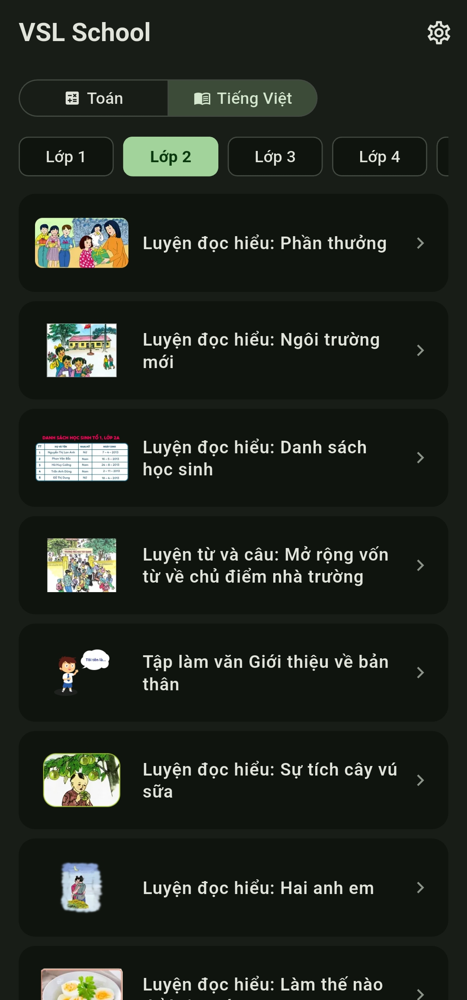
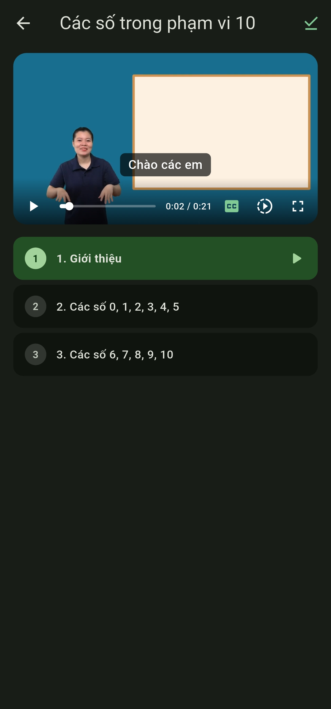
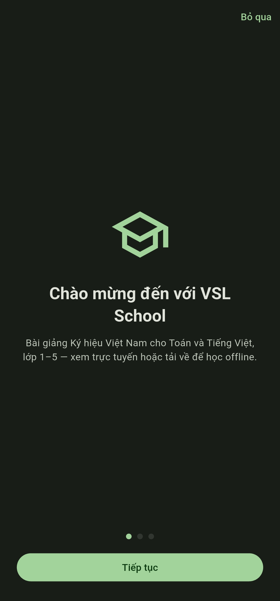
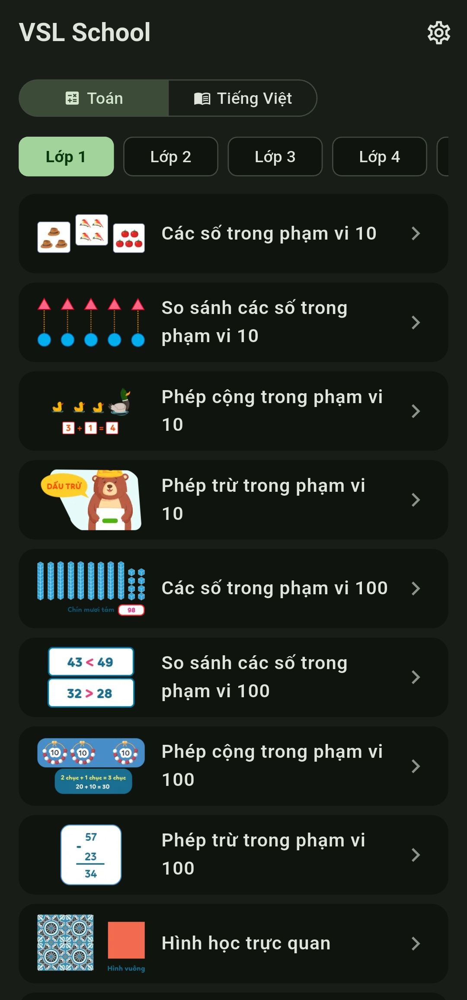
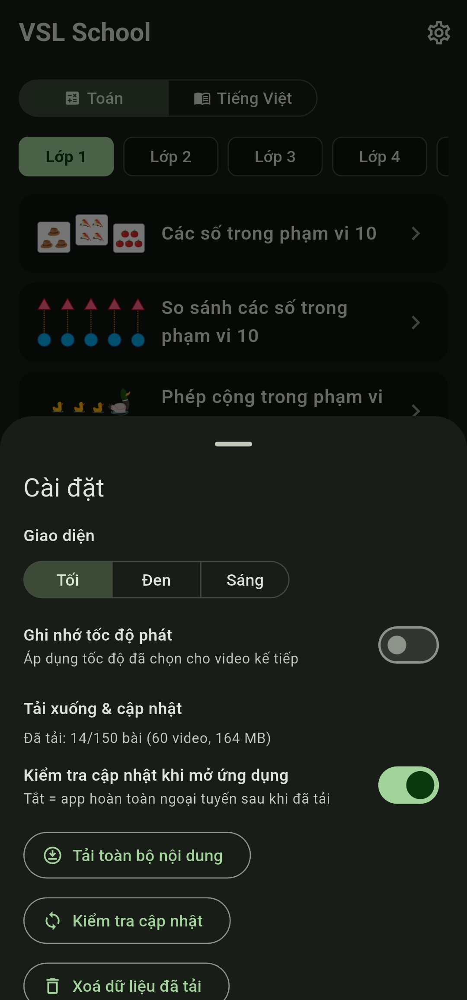
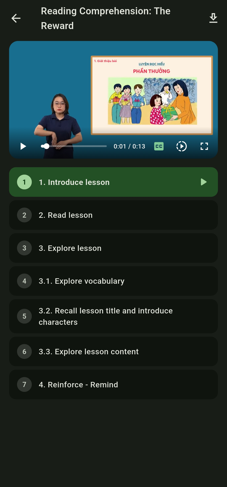

# VSL School — Trường học Ký hiệu Việt Nam

[English](README.md) | **Tiếng Việt**

[](https://github.com/ngozz/vsl-school/actions/workflows/build.yml)
[](LICENSE)
[](https://github.com/ngozz/vsl-school/releases)
<!-- F-Droid: [](https://f-droid.org/packages/com.ngozz.vsl_school/) -->

Ứng dụng Flutter ưu tiên offline với các **bài giảng video** ký hiệu — Toán
và Tiếng Việt cho lớp 1–5, theo chương trình tiểu học quốc gia Việt Nam.
Chắt lọc từ ứng dụng bài giảng "App Khiem Thinh" thành một trình đọc nhẹ với
trình phát video riêng. Giao diện tiếng Việt hoặc tiếng Anh.

**Nguồn dữ liệu:** nội dung bài học, video và phụ đề từ Cổng thông tin Ngôn
ngữ ký hiệu quốc gia [qipedc.moet.gov.vn (App Khiem Thinh)](https://qipedc.moet.gov.vn/)
(Trung tâm Ký hiệu Việt Nam / Bộ Giáo dục và Đào tạo).

## Ngôn ngữ

- **Giao diện:** tiếng Việt hoặc tiếng Anh (Cài đặt → Ngôn ngữ; cũng được hỏi
  khi mở ứng dụng lần đầu).
- **Nội dung:** toàn bộ nội dung giảng dạy gốc là **tiếng Việt** — chương
  trình tiểu học quốc gia, tên bài, đề mục, phụ đề và các video. Tiêu đề, đề
  mục và phụ đề tiếng Anh là lớp dịch đi kèm, chỉ hiển thị ở chế độ tiếng
  Anh; chế độ tiếng Việt giữ nguyên thuần Việt.
- Tên môn học theo giao diện: **Toán** là *Math*, **Tiếng Việt** (môn học
  đọc/viết tiếng Việt) là *Literature* trong giao diện tiếng Anh.
- *Ghi chú về bản dịch:* phần tiếng Anh được dịch với sự hỗ trợ của AI và
  được người thật soát một phần. Một số câu vẫn có thể hơi gượng — rất mong
  nhận được sửa lỗi qua issues.

## Cài đặt

- **Android:** APK đã ký mới nhất tại
  [Releases](https://github.com/ngozz/vsl-school/releases)
  (`vsl-school-android.apk` — bài học phát từ CDN và tải về trong ứng dụng
  để dùng offline).
- **Web:** <https://ngozz.github.io/vsl-school/>
- **iOS** (IPA chưa ký): thêm vào SideStore/AltStore bằng nguồn bên dưới.

## Ảnh minh họa

Giao diện tiếng Việt:

<p align="center">
  <a href="ss/1_vn.jpg"></a>&nbsp;<a href="ss/2_vn.jpg"></a>&nbsp;<a href="ss/3_vn.jpg"></a>&nbsp;<a href="ss/4_vn.jpg"></a>
</p>

Giao diện tiếng Anh:

<p align="center">
  <a href="ss/1.jpg"></a>&nbsp;<a href="ss/2.jpg"></a>&nbsp;<a href="ss/3.jpg"></a>&nbsp;<a href="ss/4.jpg"></a>
</p>

*Chạm vào ảnh để xem kích thước đầy đủ.*

## Tính năng

- **Duyệt bài học** — chip chọn môn (Toán / Tiếng Việt, hoặc Math /
  Literature) + chip chọn lớp (Lớp 1–5 / Grade 1–5), danh sách bài kèm ảnh
  thu nhỏ video.
- **Màn hình bài học** — đề mục đồng bộ với video; chạm vào mục bất kỳ để
  nhảy đến phần đó.
- **Trình phát riêng** (`lib/widgets/lesson_video_player.dart`, dựa trên
  `video_player`) — phát H.264/AAC mp4, phụ đề SRT (tiếng Việt, hoặc tiếng
  Anh ở giao diện tiếng Anh) với nút CC, menu tốc độ (0.25×–1.5×), điều
  khiển ẩn/hiện khi chạm, toàn màn hình xử lý dọc/ngang.
- **Nội dung tiếng Anh** — tiêu đề, đề mục và phụ đề tiếng Anh; phụ đề đổi
  theo ngôn ngữ giao diện.
- **Cá nhân hóa** — ghi nhớ tốc độ phát, ba giao diện (tối / đen hoàn toàn
  AMOLED / sáng, Material 3 xanh lá), tải xuống kèm kiểm tra cập nhật.

## Cấu trúc dự án

```
vsl-school/
├── data/
│   ├── json/            # title.json (danh mục bài) + translate.json, exercises/, interactive/ (dành cho tương lai)
│   │   └── tablecontent/  # 150 đề mục bài học (ánh xạ đoạn + video)
│   ├── videos/          # 772 video bài học đã encode lại (H.264 mp4 + AAC)
│   ├── srt/             # 753 file phụ đề tiếng Việt (SRT)
│   ├── srt_en/          # 751 file phụ đề tiếng Anh (SRT)
│   └── thumbs/          # 150 ảnh thu nhỏ bài học (WebP)
├── lib/
│   ├── main.dart        # điểm vào app + theme Material You
│   ├── models/lesson.dart
│   ├── services/        # danh mục bài học, cài đặt, tải xuống, phụ đề
│   ├── screens/         # home (duyệt) + màn hình bài học
│   └── widgets/lesson_video_player.dart
├── ss/                  # ảnh chụp dùng trong README này (giao diện Việt + Anh)
├── .github/workflows/   # CI build + release (xem bên dưới)
└── icon.png             # nguồn icon launcher
```

Phần dữ liệu do tôi thực hiện: media gốc thời Unity (.webm) được encode lại
thành H.264/AAC mp4 để chạy đa nền tảng, phụ đề xuất ra SRT.

## Build

```bash
flutter pub get
flutter run                          # chạy trên thiết bị (flavor lite)
flutter build apk --release          # Android, lite (flavor mặc định; CI ký release)
flutter build apk --release --flavor full   # Android, kèm video (~3 GB)
flutter build web --release          # Web → build/web (luôn lite)
flutter build ios --no-codesign --flavor lite  # iOS (cần Xcode + macOS)
```

`lite` là flavor mặc định (`default-flavor: lite`); `full` kèm
`data/videos/` và thêm `.full` vào application ID (Android) / bundle ID (iOS)
nên cài song song với bản lite được. CI chỉ phát hành bản lite. Web build
dùng flavor mặc định (lite) nên không bao giờ kèm video.

### Ký release Android

Keystore được tạo **một lần** và giữ mãi mãi: Android không cho cập nhật ứng
dụng đã cài nếu khóa ký thay đổi. Hãy sao lưu (ví dụ Google Drive) và không
bao giờ commit — `android/key.properties`, `*.jks` và `*.keystore` bị
git-ignore.

```powershell
# từ vsl-school/android/app
keytool -genkeypair -v -keystore vsl-school.jks -storetype PKCS12 `
  -keyalg RSA -keysize 2048 -validity 10000 -alias vsl-school
```

- Dùng **một mật khẩu** cho store và key (PKCS12 yêu cầu vậy).
- Mất keystore nghĩa là mọi người dùng phải gỡ cài đặt trước khi cập nhật.

Thêm bốn repository secrets (**Settings → Secrets and variables → Actions**):

| Secret | Giá trị |
|---|---|
| `ANDROID_KEYSTORE_BASE64` | kết quả PowerShell bên dưới |
| `ANDROID_STORE_PASSWORD` | mật khẩu keystore |
| `ANDROID_KEY_ALIAS` | `vsl-school` |
| `ANDROID_KEY_PASSWORD` | giống mật khẩu store |

```powershell
[Convert]::ToBase64String([IO.File]::ReadAllBytes("vsl-school.jks"))
```

CI giải mã vào `android/app/vsl-school.jks` và ghi `android/key.properties`
(`storeFile=vsl-school.jks`) trước khi `flutter build apk --release`; thiếu
secret thì APK được ký debug.

**Chuyển đổi một lần:** APK trước đây được ký debug nên Android không cho cài
bản ký release đè lên. Gỡ ứng dụng cũ một lần (điều này cũng xóa video đã tải
và cài đặt), rồi cài APK mới.

## CI/CD (GitHub Actions)

`.github/workflows/build.yml` build và publish tự động. Trigger:

| Trigger | Kết quả |
|---|---|
| Commit có **tin nhắn chứa `[build]`** | Build đủ: Android APK + Web + iOS IPA chưa ký |
| **Thủ công** (`workflow_dispatch`) | Như trên, bất cứ lúc nào |
| Push khác | CI được bỏ qua có chủ đích |

Mỗi lần build **tạo một GitHub Release** (`build<số-run>`) chứa:

- `vsl-school-android.apk` — cài trực tiếp được (được ký release trong CI)
- `vsl-school-ios-unsigned.ipa` — chưa ký; ký lại hoặc dùng công cụ sideload
  (ví dụ AltStore, Sideloadly) để cài
- `vsl-school-web.zip` — bản web tĩnh

Bản web cũng được **triển khai lên GitHub Pages** tự động mỗi lần build
`main` (base path được ném vào lúc build nên chạy được dưới `/<repo>/`), tại
`https://ngozz.github.io/vsl-school/`.

Muốn đưa lên Play Store hay F-Droid? Xem [PUBLISHING.md](PUBLISHING.md).

## iOS qua SideStore / AltStore

Bản iOS có thể thêm vào SideStore hoặc AltStore bằng nguồn này:

```
https://ngozz.github.io/vsl-school/altstore-source.json
```

Nó trỏ tới bản IPA chưa ký mới nhất; SideStore/AltStore ký khi cài (cùng cơ
chế với vsl-dictionary). File nằm ở `web/altstore-source.json` và được đẩy
lên Pages theo mỗi bản web — tăng `version`/`date` khi muốn SideStore thấy
bản cập nhật.

### Ghi chú setup repo

1. Bật **Actions → Settings → Pages → GitHub Pages** với nguồn là workflow
   (job `deploy-pages` tự cấu hình việc này).
2. APK Android được **ký release** trong CI từ bốn repository secrets:
   `ANDROID_KEYSTORE_BASE64` (base64 của `vsl-school.jks`),
   `ANDROID_STORE_PASSWORD`, `ANDROID_KEY_ALIAS` (`vsl-school`) và
   `ANDROID_KEY_PASSWORD`. Thiếu chúng bản build sẽ ký debug nên fork và chạy
   local vẫn hoạt động. Xem [Ký release Android](#ký-release-android).
3. Build iOS không cần setup thêm (không có cấu hình ký = IPA chưa ký trên
   macOS runner).
4. Media (~2,7 GB) làm repo nặng; cân nhắc [`git lfs`](https://git-lfs.com)
   cho `data/videos/*` nếu gặp giới hạn push — hoặc bỏ media khỏi git và
   phát từ CDN ở vòng sau. Lưu ý: máy build của F-Droid clone cả repo nên
   cần làm gọn trước khi gửi (xem [PUBLISHING.md](PUBLISHING.md)).

## Ghi công dữ liệu

Nội dung bài học lấy từ cổng ngôn ngữ ký hiệu quốc gia
[App Khiem Thinh (qipedc.moet.gov.vn)](https://qipedc.moet.gov.vn/)
(Trung tâm Ký hiệu Việt Nam / Bộ Giáo dục và Đào tạo). Dự án này là trình đọc
dùng cá nhân, không phải sản phẩm gốc.

## Giấy phép

[MIT](LICENSE) — nội dung bài học thuộc về nhà xuất bản gốc của nó (xem ghi
công ở trên).
